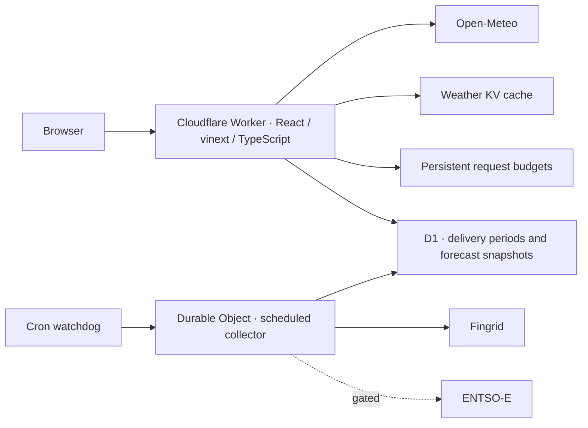

# Säävirta

<picture>
  <source media="(prefers-color-scheme: dark)" srcset="docs/assets/saavirta-logo-dark.png">
  
</picture>

[Live application](https://www.saavirta.workers.dev) · [Build and deploy](https://github.com/harshithbhaskar69/saavirta/actions/workflows/release.yml)

Weather and electricity-market context for an electricity retailer. Select a point worldwide to inspect hourly temperature, irradiance, wind and precipitation. For Finland, the **Delivery desk** aligns national demand, generation forecasts and collected forecast changes by delivery period.

The retailer can see when forecast demand is less covered by wind and solar, how the outlook changed during the last hour, and how completed demand compares with a forecast collected approximately 24 hours earlier. These are transparent national indicators, not portfolio volumes, trading recommendations or price predictions. Selected-point weather provides local context; it is not a Finland-wide weather estimate.

## Architecture



One Worker serves the app and APIs. A Durable Object serializes market collection and persists provider quotas; browser requests only read stored market data. D1 retains 30 days of normalized periods and immutable forecast snapshots. React shares a UTC cursor across charts; TypeScript on the server owns market calculations.

**Data:** live fundamentals use authenticated Fingrid responses and pinned National Land Survey boundaries. ENTSO-E prices remain unavailable until REST access and redistribution permission are verified. Explicit demonstration mode uses mathematical curves with no live inputs; it cannot run in production. [Data meanings and formulas](docs/markets/README.md).

## Run locally

Use Node 26.7.0 and npm 10.9.8, as pinned in CI:

```sh
npm ci
npm run db:local
npm run dev
```

Open http://127.0.0.1:3000. Global weather works without credentials. Market sections remain unavailable until data is collected. The first visit has no default city or automatic location prompt; the bundled map needs no API key.

For a clearly labelled, self-contained market demonstration:

```sh
npm run markets:demo
```

All credentials belong in Infisical, never `.env` or `.dev.vars` files. [Secret setup](docs/markets/secrets.md) explains optional authenticated local work. Never run a local collector with the production Fingrid key. Unsaved device coordinates use POST, stay outside URLs and shared caches, and are never stored in D1.

## Verify

```sh
npm run check
npm run test:runtime
node scripts/market-openapi.mjs --check
node scripts/dependency-audit.mjs
npm run build
npm run test:e2e
```

Install Chrome with `npx playwright install chrome`. CI checks types, lint, unit tests, D1 transactions and Durable Object persistence under workerd, desktop/mobile E2E, dependencies, secrets and Terraform. It deploys the exact tested Worker artifact. Ordinary CI uses deterministic fixtures and makes no authenticated provider requests.

## Deployment

[www.saavirta.workers.dev](https://www.saavirta.workers.dev) runs entirely on Cloudflare. Terraform owns D1, weather KV and private R2 state. Wrangler publishes the Worker, bindings, Durable Objects and Cron configuration. GitHub Actions authenticates to Infisical through OIDC; only provider keys become Worker secrets. No container image or registry is needed.

[Operations and recovery](docs/markets/operations.md) · [Terraform](infra/README.md) · [Secrets and OIDC](docs/markets/secrets.md) · [Verification](docs/markets/verification.md) · [Release gates](docs/markets/release-gates.md) · [Security assessment](docs/markets/security.md)

The current deployment uses Open-Meteo's non-commercial public service. Commercial operation requires an appropriate weather plan. Historical/model-run features remain subject to provider entitlements. [THIRD_PARTY_NOTICES.md](THIRD_PARTY_NOTICES.md) records source and asset acknowledgements.
